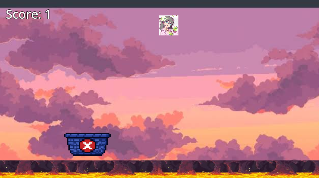

# Please Review Cloud
## Made By Tung Tung Tung Sahir
### So that Cloud reviews Fast enough
---
# Code and Made 

 I Have Made this game in godot and is little similar to my project made for Haven but not same copy but some parts are same  
      I also used some images as asset made by ai rest all is done by me  
      I have used the scripting part of falling cloud from haven and also the lava touch to kill part  
      I have used area2d and collision body 2d to make when cloud touches the basket he dissapears and we get score and if touch the lava the game ends which takes us to leaderboard 
      Also If i get approved will ask cloud to voice it until the end of the world  
      If you like it cloud please DM me with voices to add to this game  
      Everything of this game is open source so if you need to make your own you can  
      Thank you for reading this bullshit   

  You Can Play it on Itch.io - https://tungtungtungsahir.itch.io/please-review-cloud

# How to play 
## You can either slide the basket with the cursor or with A and D key or even with the arrow keys but you cant move up or down 

## collect cloud in the basket to increase score 

## submit you score and get ranked on leaderboard

# Images 

# Cloud please do not sue me please and i need coffee please review fast
